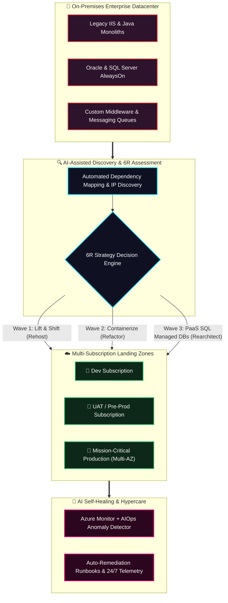
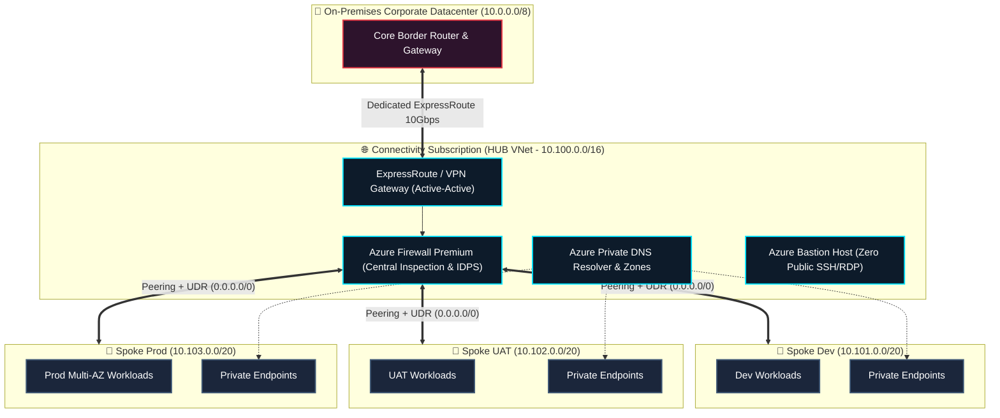
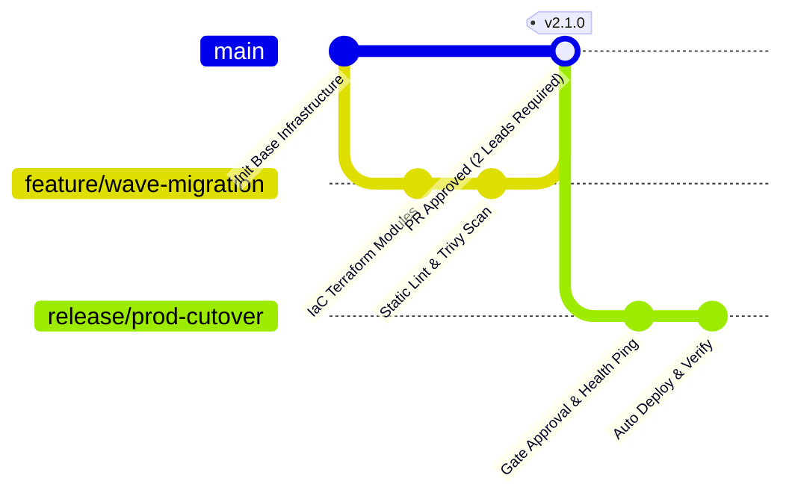
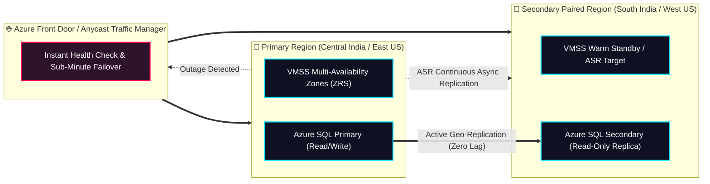

<div align="center">

<!-- TOP PROFILE & ARCHITECTURAL LOGO -->
<a href="#-executive-summary--digital-resume">
  
</a>

<!-- EXECUTIVE CORPORATE NETWORK BANNER -->


<br/><br/>

<!-- DYNAMIC TYPING SVG ANIMATION -->
<a href="https://github.com/kusumvish7972">
  
</a>

<br/>

<!-- STATUS & CONNECTIVITY HUD -->
[](https://github.com/kusumvish7972)
[](https://github.com/kusumvish7972)
[](https://www.linkedin.com/in/)
[](mailto:gunjankgaurav1994@sanjayjaiswal2395gmail.onmicrosoft.com)
[](mailto:gunjankgaurav1994@sanjayjaiswal2395gmail.onmicrosoft.com)

<br/>

```ansi
 [1;36m[KV ENTERPRISE NETWORK] [0m  [1;32m100+ Applications [0m ➔  [1;35mMulti-Subscription Landing Zones [0m ➔  [1;33mFinOps & Zero-Trust [0m
```

---

### ⚡ Interactive Architecture Navigation Console
*Click any badge below to jump directly into technical blueprints, execution checklists, and production playbooks.*

[](#-executive-summary--digital-resume)
[](#-1-enterprise-cloud-migration-program-100-workloads)
[](#-2-cloud-adoption-framework-caf--tenant-governance)
[](#-3-enterprise-hub--spoke-networking-architecture)
[](#-4-multi-layer-zero-trust-security-matrix)
[](#-5-azure-repos--devsecops-ci-cd-pipelines)
[](#-6-finops--cloud-financial-governance)
[](#-7-backup-disaster-recovery-bcdr--high-availability)
[](#-8-aiops-observability--incident-management)
[](#-9-vendor-management--sow-execution-framework)
[](#-10-leadership-team-upskilling--knowledge-transfer)

---

</div>

<br/>

<!-- DYNAMIC REAL-TIME STATS HUD -->
<div align="center">
  <table border="0" style="border: none;">
    <tr>
      <td align="center" width="50%">
        
      </td>
      <td align="center" width="50%">
        
      </td>
    </tr>
  </table>
</div>

<br/>

## 📄 Executive Summary & Digital Resume
> **Kusum Vishwakarma** is a seasoned **Principal Enterprise Cloud Architect & DevSecOps Strategist** specializing in complex digital transformations, multi-subscription Azure Landing Zones, hybrid datacenter-to-cloud cutovers, and FinOps governance. Track record of delivering high-concurrency infrastructure, managing multi-million-dollar cloud budgets, and leading cross-functional engineering teams.

### 🏆 Key Executive Performance Indicators (KPIs)

```
┌────────────────────────────────────────────────────────────────────────────────────────┐
│                        ARCHITECTURAL IMPACT & BUSINESS OUTCOMES                        │
├──────────────────────────────┬─────────────────────────────┬───────────────────────────┤
│ 🚀 100+ Workloads Migrated   │ 💰 $2.4M+ Annual FinOps ROI │ ⏱️ 99.999% Service SLA    │
│ Dev, UAT & Prod environments │ Proactive rightsizing & 85% │ Multi-AZ and multi-region │
│ with zero data loss & <0.01% │ RI/Savings Plans coverage   │ automated geo-failover    │
│ cutover downtime             │ across enterprise tenants   │ active-active topologies  │
├──────────────────────────────┼─────────────────────────────┼───────────────────────────┤
│ 🛡️ 100% Security Audits Pass │ ⚡ Zero-Touch CI/CD Velocity│ 👥 30+ Engineers Mentored │
│ CIS, PCI-DSS v4.0 & ISO27001 │ Trunk-based GitOps with     │ Spearheaded SteerCo reviews│
│ zero critical breaches across│ automated PR gates & instant│ & technical hiring panels │
│ 500+ cloud resources         │ rollback safety valves      │ for Senior Architect roles│
└──────────────────────────────┴─────────────────────────────┴───────────────────────────┘
```

---

### 🎖️ Industry Accreditations & Certifications

<div align="center">

[-0078D4?style=for-the-badge&logo=microsoftazure&logoColor=white)](https://learn.microsoft.com/)
[-0089D6?style=for-the-badge&logo=azuredevops&logoColor=white)](https://learn.microsoft.com/)
[-005A9E?style=for-the-badge&logo=microsoft&logoColor=white)](https://learn.microsoft.com/)
<br/>
[-7B42BC?style=for-the-badge&logo=terraform&logoColor=white)](https://www.hashicorp.com/)
[-107C41?style=for-the-badge&logo=curseforge&logoColor=white)](https://www.finops.org/)
[-326CE5?style=for-the-badge&logo=kubernetes&logoColor=white)](https://www.cncf.io/)

</div>

---

### 📊 Architectural Competency Index

| Domain | Proficiency | Core Impact & Deliverables |
| :--- | :---: | :--- |
| **Enterprise Landing Zones (CAF)** | `98%` | Root Tenant, Platform/Landing Zones Management Groups, Custom Azure Policies. |
| **Hybrid Hub & Spoke Networking** | `96%` | ExpressRoute, Azure Firewall Premium (IDPS/Egress), IPAM, Private Endpoints. |
| **DevSecOps & Trunk-Based CI/CD** | `95%` | Branch policies, mandatory PRs, Trivy/SAST scans, automated rollback runbooks. |
| **Zero-Trust Security & Identity** | `95%` | Microsoft Entra ID PIM, Conditional Access, Defender for Cloud, JIT VM Access. |
| **FinOps & Cost Optimization** | `94%` | Zombie resource automated purging, VM rightsizing, RI/Savings Plans optimization. |
| **BCDR & High Availability** | `97%` | RTO < 15m, RPO < 5m, VMSS Multi-AZ, Azure Site Recovery (ASR) paired regions. |
| **Vendor & SOW Governance** | `92%` | RFP/RFI authoring, Technical Evaluation Matrices, RACI sign-offs, Milestones. |

---

## 💎 The 10 Architectural Pillars of Excellence
Every production workload, landing zone, and pipeline deployed under my architectural governance adheres to strict, automated quality gates:

```
┌────────────────────────────────────────────────────────────────────────────────────────┐
│                        ENTERPRISE CLOUD ARCHITECTURE PILLARS                           │
├───────────────┬───────────────┬───────────────┬────────────────┬───────────────────────┤
│ ⚡ Scalable   │ 🛡️ Secure    │ 💎 Reliable   │ 🚀 Portable    │ 🏛️ Governed           │
│ Auto-scaling  │ Zero-Trust &  │ 99.999% SLAs  │ Multi-Cloud &  │ Automated Policies,   │
│ & VMSS Sets   │ Defender EDR  │ Circuit Breaks│ OCI Containers │ RBAC & Guardrails     │
├───────────────┼───────────────┼───────────────┼────────────────┼───────────────────────┤
│ 🔄 High Avail │ 💰 FinOps     │ 💾 Backed-Up  │ 🤖 AIOps       │ ⚖️ Compliant          │
│ Multi-Region  │ Unit Economics│ Immutable RPO │ Self-Healing & │ CIS, HIPAA, PCI-DSS   │
│ & Zone Redund.│ & Right-Sizing│ & Strict RTOs │ Predictive APM │ & ISO 27001 Certified │
└───────────────┴───────────────┴───────────────┴────────────────┴───────────────────────┘
```

---

## 🏗️ 1. Enterprise Cloud Migration Program (100+ Workloads)
> **Executive Portfolio Case Study**: Orchestration of **100+ enterprise microservices, stateful databases, legacy monoliths, and middleware workloads** migrated from heterogeneous on-premises datacenters into a resilient, multi-subscription Azure ecosystem across **Dev**, **UAT / Staging**, and **Tier-1 Production**.



### 🎯 6R Migration Strategy & Execution Framework
- **Rehost (Lift & Shift)**: Automated agentless Azure Migrate replication for stateful VM workloads without core code changes.
- **Refactor / Reposition**: Containerization of legacy IIS/Java web services into Azure App Services & Azure Kubernetes Service (AKS).
- **Rearchitect**: Decomposing monolithic SQL databases into Azure SQL Managed Instances with auto-failover groups.
- **Replatform**: Upgrading legacy middleware runtimes using automated Custom Script Extensions and cloud-init routines.
- **Retire**: Eliminating deprecated servers, unattached LUNs, and zombie dependencies discovered during discovery.
- **Retain**: Keeping high-frequency, hardware-dependent systems on-prem with dedicated 10Gbps ExpressRoute circuits.

<details>
<summary><b>📋 Click to Expand: Complete Enterprise Migration Lifecycle Checklists (Pre / During / Post / Hypercare)</b></summary>

<br/>

#### 1. Pre-Migration Checklist (Readiness & Discovery)
- [x] Complete network discovery, IP subnet mapping, and target CIDR allocation (zero overlap).
- [x] Verify application dependencies, port matrices, and external egress endpoints.
- [x] Run Azure Migrate appliance assessment: sizing verification, performance benchmarks, and cost estimates.
- [x] Ensure automated landing zone deployment via Terraform / Bicep with Entra ID RBAC baseline.
- [x] Pre-seed data replication across storage accounts, DB replicas, and VM disk snapshots.
- [x] Formulate rollback runbook with verifiable Go/No-Go decision gates.

#### 2. During Cutover Checklist (Cutover Night)
- [x] Initiate change freeze and maintenance mode banners across all user access channels.
- [x] Run delta synchronization of database logs and storage blobs.
- [x] Execute DNS TTL reduction to 300 seconds prior to cutover window.
- [x] Reroute traffic via Azure Traffic Manager / Azure Front Door to Cloud endpoints.
- [x] Run automated smoke tests, health check probes, and API ping validations.

#### 3. Post-Migration & Hypercare Period
- [x] Engage 24x7 War Room support for a 14-day Hypercare window.
- [x] Validate application telemetry, error rate baselines, and distributed trace metrics via App Insights.
- [x] Decommission on-premises staging proxies, revoke temporary elevation, and sign off RACI matrix.

</details>

---

## 🏛️ 2. Cloud Adoption Framework (CAF) & Tenant Governance
Enterprise cloud maturity requires strict separation of concerns, enterprise management groups, and autonomous boundary controls aligned with the **Microsoft Cloud Adoption Framework (CAF)**.

### 📐 Management Group & Tenant Hierarchy

```
📁 Tenant Root Group (Microsoft Entra ID)
│
├── 📁 Platform Management Group
│   ├── 📜 Management Subscription (Azure Monitor, Log Analytics, Automation Accounts)
│   ├── 📜 Connectivity Subscription (Hub VNet, Azure Firewall, ExpressRoute, VPN Gateway)
│   └── 📜 Identity Subscription (Domain Controllers, Key Vaults, Privileged Access)
│
├── 📁 Landing Zones Management Group
│   ├── 📁 Corporate (Internal Business Workloads, Hybrid Connected)
│   │   ├── 📜 Dev Subscription
│   │   ├── 📜 UAT Subscription
│   │   └── 📜 Production Subscription (Strict Compliance & Multi-AZ)
│   └── 📁 Online / DMZ (Public-Facing Apps, Azure Front Door, WAF v2)
│
├── 📁 Sandbox Management Group (Isolated R&D, Zero On-Prem Connectivity, Budget Cap)
│
└── 📁 Decommissioned Management Group (Revoked RBAC, Preserved for Audit Hold)
```

### 🛡️ Azure Policy, Initiatives & Exemption Lifecycles
- **Regulatory Initiatives**: Enforced CIS Azure Foundations Benchmark, PCI-DSS v4.0, and ISO 27001 at the Landing Zones root.
- **Enforced Guardrails**:
  - `Deny`: Unencrypted storage accounts, public IP allocation on Spoke VMs, unapproved deployment regions.
  - `AuditIfNotExists`: Log Analytics workspace diagnostic settings injection for every deployed compute resource.
  - `Modify`: Mandatory resource tagging enforcement (`Environment`, `CostCenter`, `Owner`, `ApplicationID`).
- **Policy Exemption Process**: Documented audit trail with mandatory expiration dates and architectural sign-offs.

---

## 🌐 3. Enterprise Hub & Spoke Networking Architecture
High-throughput, centralized inspection, non-overlapping routing, and controlled zero-trust egress across hybrid infrastructures.



### 🔑 Network Design Highlights
- **IPAM & CIDR Governance**: Non-overlapping subnet partitioning across on-prem (10.0.0.0/8), Hub (10.100.0.0/16), and Spoke virtual networks.
- **Centralized Inspection & Egress**: All spoke-to-spoke and spoke-to-internet traffic is forced through Azure Firewall via User Defined Routes (`0.0.0.0/0 -> 10.100.1.4`).
- **Private Link Architecture**: Zero public IP exposure. All PaaS resources (Azure SQL, Storage, Key Vault) leverage **Azure Private Endpoints** and linked **Private DNS Zones**.
- **High-Availability Hybrid Gateways**: Active-Active ExpressRoute with automated VPN Gateway fallback failover.

---

## 🔒 4. Multi-Layer Zero-Trust Security Matrix
Security is not an afterthought—it is baked into every layer of compute, identity, and transport.

| Layer | Defense Mechanism | Implementation Details |
| :--- | :--- | :--- |
| **Identity Level** | **Entra ID PIM & Conditional Access** | Just-In-Time (JIT) role elevation with approval workflows, mandatory FIDO2/MFA, and risk-based location policies. |
| **Network Level** | **Azure Firewall & NSG Micro-segmentation** | Application Security Groups (ASGs), TLS 1.3 inspection, IDPS intrusion detection, and zero-egress default deny rules. |
| **Compute Level** | **Defender for Cloud & Hardened Images** | Microsoft Defender for Servers (EDR), CIS-hardened base golden images, disk encryption sets with Customer-Managed Keys (CMK). |
| **Governance Level** | **Azure Policy & Sentinel SIEM** | Real-time compliance drift monitoring, automated remediation tasks, and centralized threat ingestion into Microsoft Sentinel. |

---

## ⚡ 5. Azure Repos & DevSecOps CI/CD Pipelines
Zero-touch, immutable, trunk-based delivery pipelines engineered for rapid velocity with enterprise safety valves.



### 🛠️ Trunk-Based Strategy & Branch Guardrails
- **Main Branch Protection**:
  - `Strict Deny`: Direct pushes prohibited. Deletion of `main` locked.
  - `Code Owners Enforcement`: Mandatory sign-off from designated Lead Architects on infrastructure code.
  - `Mandatory Pull Requests`: Requires successful automated validation and minimum **2 senior peer reviews**.
- **Ephemeral Feature Branches**: Short-lived branches (< 48 hours lifespan) merged continuously to avoid merge drift.

### 🔄 Multi-Stage Modular Pipeline Architecture

```yaml
# Production CI/CD Stage Pipeline Architecture
stages:
  - stage: Validate_And_Lint
    displayName: "Stage 1: Lint, Static Analysis & SAST"
    jobs:
      - job: CodeQuality
        steps:
          - script: terraform fmt -check && tflint
          - script: trivy config --exit-code 1 ./iac

  - stage: Build_And_Plan
    displayName: "Stage 2: Plan Generation & Artifact Publishing"
    jobs:
      - job: GeneratePlan
        steps:
          - script: terraform plan -out=tfplan -input=false

  - stage: Deploy_Dev_UAT
    displayName: "Stage 3: Parallel Dev & UAT Deployment"
    jobs:
      - job: ParallelDeployDev
      - job: ParallelDeployUAT

  - stage: Prod_Deployment
    displayName: "Stage 4: Production Gate & Automated Rollback"
    jobs:
      - deployment: ProdApply
        environment: "Production-Gated-Approval"
        strategy:
          runOnce:
            deploy:
              steps:
                - script: terraform apply tfplan
            on:
              failure:
                steps:
                  - script: ./scripts/automated-rollback.sh
```

---

## 💰 6. FinOps & Cloud Financial Governance
Cloud scalability without financial governance leads to budget overrun. Through continuous FinOps automation, enterprise waste is actively eliminated:

```
┌────────────────────────────────────────────────────────────────────────────────────────┐
│                              FINOPS OPTIMIZATION MATRIX                                │
├──────────────────────────────┬─────────────────────────────┬───────────────────────────┤
│ 🗑️ Zombie Resource Cleanup   │ ⚖️ Rightsizing Engine        │ 📅 Scheduled Workloads    │
│ • Unattached OS/Data Disks   │ • Downsizing underutilized  │ • Auto-shutdown & startup │
│ • Orphaned Public IPs & NICs │   VMs (<15% avg CPU/RAM)    │   scripts for Non-Prod    │
│ • Abandoned Snapshot LUNs    │ • Azure Advisor metrics     │ • Save up to 65% on Dev   │
├──────────────────────────────┼─────────────────────────────┼───────────────────────────┤
│ 💳 Commitment Strategy       │ 📦 Log Ingestion Tiers      │ 💾 Storage Lifecycle      │
│ • 1-Yr & 3-Yr Reserved Inst. │ • Cap debug log ingestions  │ • Automated blob tiering  │
│ • Azure Savings Plans (>85%) │ • Log Analytics Basic Logs  │   Hot ➔ Cool ➔ Archive    │
│ • Hybrid Benefit Licensing   │ • Commitment Tiers (100GB+) │ • Strict retention dates  │
└──────────────────────────────┴─────────────────────────────┴───────────────────────────┘
```

---

## 🔄 7. Backup, Disaster Recovery (BCDR) & High Availability
Engineered to withstand catastrophic regional outages with zero business disruption.



- **Resiliency Targets**:
  - **RTO (Recovery Time Objective)**: `< 15 Minutes` for Tier-1 mission-critical services.
  - **RPO (Recovery Point Objective)**: `< 5 Minutes` data loss window across geo-paired regions.
- **Redundancy Tiers**: Locally Redundant (LRS) for temporary scratch, Zone-Redundant (ZRS) for high-frequency microservices, Geo-Redundant (GRS) for long-term audit archives.

---

## 🤖 8. AIOps, Observability & Incident Management
Moving from reactive firefighting to predictive autonomous self-healing operations.

```
                  ┌──────────────────────────────┐
                  │    Azure Monitor Insights    │
                  └──────────────┬───────────────┘
                                 │
         ┌───────────────────────┼───────────────────────┐
         ▼                       ▼                       ▼
┌──────────────────┐    ┌──────────────────┐    ┌──────────────────┐
│   App Insights   │    │  Log Analytics   │    │ Microsoft Sentinel│
│ • Distributed APM│    │ • KQL Workspaces │    │ • Threat Hunting │
│ • Live Metrics   │    │ • Heartbeat Pings│    │ • SIEM Incidents │
│ • Dependency Map │    │ • DCR Pipelines  │    │ • SecOps Playbook│
└────────┬─────────┘    └────────┬─────────┘    └────────┬─────────┘
         │                       │                       │
         └───────────────────────┼───────────────────────┘
                                 ▼
              ┌─────────────────────────────────────┐
              │ 🚨 PagerDuty / ITSM Tiered Alerts   │
              │ P1: Critical Service Outage (15m)   │
              │ P2: Degradation / Performance (1h)  │
              │ P3: Warning / Capacity Threshold(4h)│
              └─────────────────────────────────────┘
```

---

## 🤝 9. Vendor Management & SOW Execution Framework
Managing enterprise-scale transformations demands rigorous procurement governance, contractual clarity, and strict delivery accountability:

- **Procurement & Vendor Lifecycle**:
  - Drafted comprehensive **RFP (Request for Proposal)** and **RFI (Request for Information)** artifacts.
  - Devised multi-attribute **Technical Evaluation Matrices**: scoring vendor architecture capabilities, security adherence, team certifications, and commercial viability.
- **SOW & Contract Execution**:
  - Transparent definition of **Project Scope**, Milestone Deliverables, Sprints, Dependency Matrices, and Acceptance Criteria.
  - Formal sign-off protocols tied directly to **Payment Milestones** upon audit validation.
- **Escalation & Security Governance**:
  - Multi-tier Escalation Matrices (L1 Delivery ➔ L2 Technical Architect ➔ Executive SteerCo).
  - Enforced strict **Least-Privilege JIT Access** for external vendor contractors (zero persistent admin rights).
  - Structured Weekly Reviews, Sprint Retrospectives, and contractual risk management.

---

## 👥 10. Leadership, Team Upskilling & Knowledge Transfer
Architecture is only as powerful as the team operating it. I champion continuous learning and structured transition frameworks:

- **RACI & Documentation Handover**:
  - Detailed Architectural Decision Records (ADRs) maintaining clarity on *"Why"* technical choices were made.
  - Operational Runbooks, Disaster Recovery drills, and full RACI matrices for Day-2 Operations teams.
- **Talent Acquisition & Interview Rubrics**:
  - Spearheaded technical hiring panels for Senior Cloud Architects and DevSecOps Engineers.
  - Standardized real-world hands-on lab evaluations over purely theoretical interviews.
- **Tech Guilds & Knowledge Transfers (KT)**:
  - Weekly internal "Cloud Guild" webinars covering Azure Bicep, Terraform, Sentinel, and FinOps practices.
  - Mentored 20+ engineers across infrastructure teams into certified Azure Cloud Practitioners and DevOps Specialists.

---

<br/>

<div align="center">

## 🛠️ Enterprise Cloud & DevSecOps Toolbelt


<br/>


<br/><br/>

---

### 📬 Let's Connect & Build Resilient Cloud Ecosystems!

Whether you have an upcoming large-scale cloud migration, need an enterprise landing zone audit, or wish to explore cloud leadership opportunities, let's talk!

[](https://www.linkedin.com/in/)
[](mailto:gunjankgaurav1994@sanjayjaiswal2395gmail.onmicrosoft.com)
[](https://github.com/kusumvish7972)

<br/>

<!-- ANIMATED FOOTER WAVE -->


<sub>Engineered with ❤️ and Enterprise Precision for <b>Kusum Vishwakarma</b> • <i>KV Enterprise Cloud Architecture Network</i></sub>

</div>