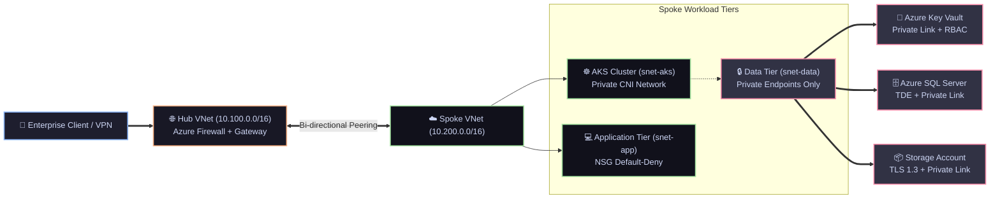

<div align="center">

<!-- TOP PROFILE & ARCHITECTURAL LOGO -->
<a href="#-executive-summary--digital-resume">
  
</a>

<!-- EXECUTIVE CORPORATE NETWORK BANNER -->


<br/><br/>

<!-- DYNAMIC TYPING SVG ANIMATION -->
<a href="https://github.com/kusumvish7972">
  
</a>

<br/>

<!-- REPOSITORY STATUS & TECH BADGES -->
[](https://www.terraform.io/)
[](https://registry.terraform.io/providers/hashicorp/azurerm/latest)
[](#-modular-architecture-child--parent-modules)
[](#-zero-trust-security--compliance-matrix)
[](.github/workflows/terraform-ci.yml)
[](LICENSE)

<br/>

```ansi
 [1;36m[ENTERPRISE CLOUD PLATFORM] [0m  [1;32mClone & Deploy [0m ➔  [1;35mMulti-Environment [Dev, UAT, Prod] [0m ➔  [1;33mCIS Hardened [0m
```

---

### ⚡ Quick Navigation Console
*Click any badge below to jump directly into deployment guides, blueprints, child modules, and production playbooks.*

[](#-quickstart-clone--deploy-in-5-minutes)
[](#-modular-architecture-child--parent-modules)
[](#-multi-environment-matrix-dev-uat-prod)
[](#-zero-trust-security--compliance-matrix)
[](#-devsecops-ci-cd--automated-security-gates)
[](#-lead-architect--maintainer)

---

</div>

<br/>

## 📖 Overview
This repository provides a **battle-tested, production-ready Infrastructure as Code (IaC) enterprise platform** designed using HashiCorp Terraform and Microsoft Cloud Adoption Framework (CAF) Landing Zones. 

It implements an extensible **Child and Parent Module architecture**, allowing engineers, teams, and organizations to clone this repository and spin up isolated, zero-trust cloud infrastructures across **Development (Dev)**, **Staging (UAT)**, and **Mission-Critical Production (Prod)** with zero manual configuration.

```
┌────────────────────────────────────────────────────────────────────────────────────────┐
│                        ENTERPRISE CLOUD ARCHITECTURE TOPOLOGY                          │
├──────────────────────────────┬─────────────────────────────┬───────────────────────────┤
│ 🌐 Hub & Spoke Networking    │ 🔐 Zero-Trust Identity      │ ⚡ Resilient Compute      │
│ Isolated Hub (Firewall, GW)  │ Key Vault (RBAC, Purge Prot)│ AKS with Autoscaling &    │
│ & Spoke (App, AKS, Data)     │ Managed Identity & Secret Rot│ Azure CNI Micro-seg       │
├──────────────────────────────┼─────────────────────────────┼───────────────────────────┤
│ 💾 Enterprise Database       │ 📦 Hardened Storage         │ 📊 SRE Observability      │
│ Azure SQL with TDE, Auditing │ Blob Storage TLS 1.3 only,  │ 24/7 Log Analytics & App  │
│ & Private Link connectivity  │ Versioning & Private Endpt  │ Insights Telemetry Matrix │
└──────────────────────────────┴─────────────────────────────┴───────────────────────────┘
```

---

## 🚀 Quickstart: Clone & Deploy in 5 Minutes

Anyone can clone this repository and provision their own cloud stack immediately:

### 1. Prerequisites
Ensure you have the following installed:
- [Terraform CLI (>= 1.5.0)](https://developer.hashicorp.com/terraform/downloads)
- [Azure CLI (az)](https://learn.microsoft.com/en-us/cli/azure/install-azure-cli)
- Active Microsoft Azure Subscription

### 2. Authenticate to Azure
```bash
az login
az account set --subscription "<YOUR_SUBSCRIPTION_ID>"
```

### 3. Clone Repository
```bash
git clone https://github.com/kusumvish7972/milkyinfo.git
cd milkyinfo
```

### 4. Deploy an Environment (Dev / UAT / Prod)

#### Option A: Deploy Development Environment (`dev`)
```bash
cd environments/dev
cp terraform.tfvars.example terraform.tfvars
terraform init
terraform plan -out=tfplan
terraform apply tfplan
```

#### Option B: Deploy Production Environment (`prod`)
```bash
cd environments/prod
cp terraform.tfvars.example terraform.tfvars
terraform init
terraform plan -out=tfplan
terraform apply tfplan
```

#### Option C: Quick Automation via Makefile / PowerShell
```bash
# Using Make (Linux/macOS)
make plan ENV=dev
make apply ENV=dev

# Using PowerShell (Windows)
.\scripts\manage.ps1 -Environment dev -Action plan
.\scripts\manage.ps1 -Environment dev -Action apply
```

---

## 🏗️ Modular Architecture (Child & Parent Modules)

The codebase strictly follows industry best practices for modular infrastructure:

```
milkyinfo/
├── .github/
│   ├── workflows/
│   │   ├── terraform-ci.yml       # Automated CI, linting, tfsec & checkov
│   └── pull_request_template.md   # Enterprise PR RFC checklist
├── environments/                  # 🌟 PARENT MODULES (Environment Stacks)
│   ├── dev/                       # Development environment configuration
│   │   ├── main.tf                # Invokes child modules for dev
│   │   ├── variables.tf           # Environment-specific variables
│   │   ├── outputs.tf             # Exposes provisioned endpoints
│   │   ├── providers.tf           # Azurerm provider & backend config
│   │   └── terraform.tfvars.example
│   ├── uat/                       # User Acceptance Testing / Staging
│   │   ├── main.tf
│   │   ├── variables.tf
│   │   ├── outputs.tf
│   │   └── providers.tf
│   └── prod/                      # Mission-Critical High Availability Prod
│       ├── main.tf                # Multi-AZ, GRS, Purge Protection
│       ├── variables.tf
│       ├── outputs.tf
│       └── providers.tf
├── modules/                       # 🧩 CHILD MODULES (Reusable Building Blocks)
│   ├── networking/                # Hub & Spoke VNet, Subnets, NSG, Peering
│   ├── security/                  # Azure Key Vault, Managed Identity, Private Link
│   ├── storage/                   # Hardened Storage Account, TLS 1.3, Blobs
│   ├── compute_aks/               # Kubernetes Cluster with Autoscaler & Azure CNI
│   ├── database_sql/              # Azure SQL with TDE, Auditing & Private Endpoints
│   └── monitoring/                # Log Analytics Workspace & App Insights
├── scripts/
│   └── manage.ps1                 # Cross-platform Windows PowerShell automation
├── main.tf                        # Root orchestration entrypoint
├── variables.tf                   # Root input parameters
├── outputs.tf                     # Root output attributes
├── Makefile                       # Unix build automation toolchain
├── .tflint.hcl                    # TFLint configuration for AzureRM
└── LICENSE                        # Apache 2.0 Open Source License
```

---

## 🧩 Child Modules Catalog

| Child Module | Purpose | Key Security & Governance Features |
| :--- | :--- | :--- |
| [`modules/networking`](modules/networking/) | Enterprise Hub-and-Spoke Topology | Isolated subnets (Firewall, App, AKS, Data), Default-Deny NSG, bidirectional peering. |
| [`modules/security`](modules/security/) | Zero-Trust Secrets & Identity | Key Vault with RBAC Authorization, Soft-Delete (90 days), Purge Protection, Private Link. |
| [`modules/storage`](modules/storage/) | Secure Data Lake & Blobs | Minimum TLS 1.2/1.3, public access disabled, blob versioning & retention, private endpoint. |
| [`modules/compute_aks`](modules/compute_aks/) | Production Kubernetes (AKS) | Virtual Machine Scale Sets (VMSS), Azure CNI, managed identity, Container Insights. |
| [`modules/database_sql`](modules/database_sql/) | Enterprise Relational Database | Azure SQL with Transparent Data Encryption (TDE), Entra ID admin, private endpoint. |
| [`modules/monitoring`](modules/monitoring/) | Unified Observability Engine | Log Analytics Workspace, Application Insights, Action Group alerting. |

---

## 🌍 Multi-Environment Matrix (Dev, UAT, Prod)

| Architectural Dimension | 🧪 Development (`dev`) | 🔬 Staging / UAT (`uat`) | 🚀 Production (`prod`) |
| :--- | :--- | :--- | :--- |
| **AKS Worker VM Size** | `Standard_B2s` | `Standard_D4s_v5` | `Standard_D8s_v5` |
| **AKS Node Scalability** | 1 - 3 Nodes | 2 - 6 Nodes | 3 - 12 Nodes (Multi-AZ) |
| **Storage Redundancy** | LRS (Locally Redundant) | ZRS (Zone-Redundant) | GRS (Geo-Redundant) |
| **SQL Database Tier** | Basic / S1 | S2 (50 GB) | GP_Gen5_4 (250 GB) |
| **Log Retention** | 30 Days | 60 Days | 90 Days |
| **Key Vault Purge Prot.** | Disabled (Easy teardown) | Enabled | Enabled (Strict Zero-Trust) |
| **Public IP Exposure** | None (Private Endpoints) | None (Private Endpoints) | None (Zero Public IPs) |

---

## 🛡️ Zero-Trust Security & Compliance Matrix

Every module in this repository adheres to the **CIS Azure Foundations Benchmark** and **PCI-DSS v4.0** standards:



1. **Micro-Segmentation**: Workloads communicate only across private subnets via dedicated route tables and default-deny NSGs.
2. **Private Link**: All PaaS services (SQL, Key Vault, Storage) disable public IP routing and bind strictly to private endpoints in `snet-data`.
3. **Identity-Driven Governance**: Zero hardcoded credentials. All workloads authenticate using Azure User-Assigned or System-Assigned Managed Identities with Azure Entra ID RBAC.
4. **Data at Rest & in Transit**: TLS 1.3 enforced across all transport layers; Transparent Data Encryption (TDE) active across all databases.

---

## ⚙️ DevSecOps CI/CD & Automated Security Gates

This repository includes fully automated GitHub Actions pipelines located in [`.github/workflows/terraform-ci.yml`](.github/workflows/terraform-ci.yml):

- **Terraform Format Check**: `terraform fmt -check -recursive`
- **Static Syntax Validation**: `terraform validate` across `dev`, `uat`, and `prod` parent environments
- **Security SAST Scanning**: Automated scans via **`tfsec`** for misconfigurations and security flaws
- **Compliance Policy Auditing**: Automated policy scans via **`Bridgecrew Checkov`** enforcing CIS Benchmarks

---

## 👩‍💻 Lead Architect & Maintainer

<div align="center">

### Kusum Vishwakarma
**Principal Enterprise Cloud Architect & DevSecOps Strategist**

[](https://www.linkedin.com/in/)
[](mailto:gunjankgaurav1994@sanjayjaiswal2395gmail.onmicrosoft.com)
[](https://github.com/kusumvish7972)

<br/>

[-0078D4?style=for-the-badge&logo=microsoftazure&logoColor=white)](https://learn.microsoft.com/)
[-0089D6?style=for-the-badge&logo=azuredevops&logoColor=white)](https://learn.microsoft.com/)
[-005A9E?style=for-the-badge&logo=microsoft&logoColor=white)](https://learn.microsoft.com/)
[-7B42BC?style=for-the-badge&logo=terraform&logoColor=white)](https://www.hashicorp.com/)
[-107C41?style=for-the-badge&logo=curseforge&logoColor=white)](https://www.finops.org/)
[-326CE5?style=for-the-badge&logo=kubernetes&logoColor=white)](https://www.cncf.io/)

<br/><br/>

<!-- ANIMATED FOOTER WAVE -->


<sub>Designed & Architected with Enterprise Precision • Apache 2.0 Open Source Platform</sub>

</div>
